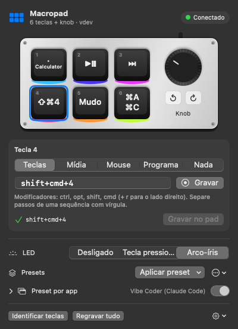
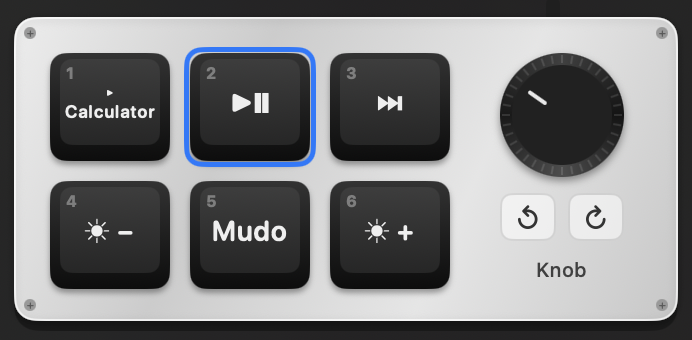

# Macropad

App nativo para macOS, na barra de menus, que configura o **macropad de 6 teclas + 1 knob** vendido
no AliExpress (família "CH57x", USB `1189:8890`). Substitui o programa do fabricante (só Windows)
e é a versão gráfica do CLI [`macropad`](https://github.com/nacif-software/vibe-coder-keyboard),
com o mesmo protocolo, a mesma sintaxe de ações e o mesmo arquivo de layout.

<p align="center">
  
</p>

O que você grava fica na memória do próprio pad: continua funcionando em qualquer computador,
sem o app aberto. (A exceção são as [teclas de programa](#teclas-de-programa), que precisam do app.)

## Instalar

Requer macOS 13 ou mais novo.

1. Baixe o **`Macropad.zip`** da [release mais nova](https://github.com/geraldoantonio/macropad-menubar/releases/latest)
   e descompacte.
2. Arraste o **Macropad.app** para **Aplicativos**.
3. O app não é assinado por um desenvolvedor Apple, então na primeira vez libere-o no Terminal:
   ```bash
   xattr -dr com.apple.quarantine /Applications/Macropad.app && open /Applications/Macropad.app
   ```
   (ou em **Ajustes → Privacidade e Segurança → Abrir Mesmo Assim**).

O ícone de grade aparece na barra de menus, cheio quando o pad está conectado. Para abrir sozinho
ao ligar o Mac: ⚙︎ → **Abrir ao iniciar sessão**.

**Idioma:** português, inglês ou espanhol. Segue o idioma do macOS (inglês para os demais);
para escolher outro, ⚙︎ → **Idioma**.

**Atualizar:** ⚙︎ → **Atualizar Macropad…** baixa a versão mais nova, troca o app e reabre.
A versão instalada aparece no cabeçalho do painel.

Não pede nenhuma permissão do macOS (nem Acessibilidade, nem Monitoramento de Entrada): o canal de
configuração do pad é uma interface USB sem driver, que o app abre direto pela mesma API que o
libusb usa.

## Usando

<p align="center">
  
</p>

Clique numa tecla, ou no knob (girar ↺, pressionar, girar ↻), escolha o que ela faz e clique em
**Gravar no pad**. O desenho mostra o que cada tecla faz e o brilho acompanha o modo do LED.

| Tipo | O que faz | Exemplos |
|---|---|---|
| **Teclas** | Um atalho ou uma sequência de até 5 atalhos. Digite ou clique em **Gravar** e aperte no teclado. | `shift+cmd+4`, `cmd+a, cmd+c` |
| **Mídia** | Volume, mudo, play/pausa, faixa anterior/próxima, brilho. | `volume-up`, `play` |
| **Mouse** | Cliques e rolagem, com modificadores. | `right-click`, `ctrl+scroll-up` |
| **Programa** | Abre um app ou link, roda um script ou um atalho do app Atalhos. | WhatsApp, `https://…`, `say oi` |
| **Nada** | Limpa a tecla. | |

Mais opções no painel:

- **LED:** desligado, tecla pressionada ou arco-íris.
- **Presets:** quatro prontos — *Vibe Coder* (para o Claude Code com ditado), *Edição*, *Mídia* e
  *Navegação* — e os seus (⋯ → **Salvar layout atual como preset…**). Também importa/exporta YAML.
  Depois de aplicar um preset aparece **Desfazer**.
- **Identificar teclas:** cada tecla passa a digitar seu número (1–6; knob 7/8/9) para você
  descobrir qual é qual. Depois clique em **Restaurar layout**.
- **Regravar tudo:** grava o layout inteiro de novo (útil se o pad foi programado por outro programa).

### Teclas de programa

O pad só sabe mandar teclas, mídia e mouse. Para abrir programas, a tecla envia um atalho reservado
(⌃⌥⇧⌘ + número ou letra) que o Macropad registra como atalho global e, quando chega, executa:

- **Abrir app** — escolha num menu com os apps abertos e todos os instalados;
- **Abrir link ou arquivo** — `https://…`, `obsidian://…`, `file:///…`;
- **Executar script** — roda no `zsh` com o seu PATH; a saída vai para `~/Library/Logs/Macropad.log`;
- **Rodar atalho do app Atalhos** — pelo nome.

O app precisa estar aberto para essas teclas funcionarem.

### Preset por app

Em **Preset por app**, ligue **Automático** e escolha um preset para cada app: o pad é regravado
sozinho quando você troca de app (em menos de um segundo). Ex.: Terminal → *Vibe Coder*,
Spotify → *Mídia*, e um preset padrão para os outros apps.

### E as camadas?

O protocolo do fabricante tem três camadas (o mesmo programa serve modelos maiores), mas este
modelo tem **uma só**: o firmware ignora a camada e a última gravação numa tecla vale para todas.
Não há botão nem combinação que troque de camada, por isso o app não mostra camadas — use
*Preset por app* para ter conjuntos diferentes de teclas.

## Arquivos

| Caminho | O que é |
|---|---|
| `~/.config/macropad/layout.yaml` | O que está gravado no pad (ele não pode ser lido de volta). Compartilhado com o CLI; `$MACROPAD_LAYOUT` muda o caminho. |
| `~/.config/macropad/presets/*.yaml` | Seus presets, no mesmo formato. |
| `~/.config/macropad/app.json` | Só do app: comandos das teclas de programa e regras por app. |
| `~/Library/Logs/Macropad.log` | Saída dos scripts. |

```yaml
led: 1
layers:
  1:
    key1: cmd+c
    key2: cmd+v
    key4: cmd+a, cmd+c
    knob-left: volume-down
    knob-press: mute
    knob-right: volume-up
```

## Sintaxe das ações

A mesma do CLI, usada no campo *Teclas* e nos arquivos YAML.

| Tipo | Exemplo | Regras |
|---|---|---|
| Combo | `cmd+shift+4` | Modificadores + no máximo uma tecla comum |
| Sequência | `cmd+a, cmd+c` | Até **5** combos separados por vírgula, sem pausas |
| Mídia | `volume-up`, `mute`, `play`, `next`, `prev`, `brightness-up` | Sozinha, sem modificadores |
| Mouse | `click`, `right-click`, `scroll-up`, `ctrl+scroll-down` | Aceita modificadores, fora de sequências |

Modificadores: `ctrl`, `opt`, `shift`, `cmd` (prefixo `r` para o lado direito: `rcmd`).
Use `backspace` ou `forward-delete` (nunca `delete`), e `comma` / `shift+equal` em vez de `,` / `+`.
F13–F24 são aceitas, mas o firmware pode não enviá-las.

## Problemas comuns

| Mensagem | O que fazer |
|---|---|
| *Macropad não encontrado (USB 1189:8890)* | Troque de porta ou cabo (alguns só carregam) e evite hubs. |
| *Não achei o canal de configuração do pad* | Desconecte e reconecte o pad; se continuar, abra uma issue com o texto completo da mensagem. |
| *Outro app já usa ⌃⌥⇧⌘…* | Outro programa registrou o mesmo atalho; grave a tecla de programa de novo para pegar outro. |
| O macOS não deixa abrir o app | Rode o `xattr` do passo 3 da instalação. |

## Desenvolvimento

```
Sources/MacropadCore     lógica pura: teclas, sintaxe, pacotes USB, layout, presets, configuração
Sources/PadUSBC          escrita USB em C via IOUSBLib (a API do libusb no macOS)
Sources/MacropadMenuBar  o app: SwiftUI (MenuBarExtra), atalhos globais, atualização
Tests/                   testes; Fixtures/ tem pacotes gerados pelo CLI Python
```

```bash
python3 scripts/check-l10n.py       # todo texto L("…") tem tradução em inglês e espanhol
swift test                          # confere byte a byte com os pacotes do CLI Python
swift run MacropadMenuBar           # roda sem empacotar
./scripts/build-app.sh --install    # empacota, copia para /Applications e abre
```

Precisa das ferramentas do Xcode (`xcode-select --install`). Cada push em `main` roda os testes e
o build no GitHub Actions e publica uma release com o `Macropad.zip` universal (Apple Silicon e
Intel) — é dela que o botão **Atualizar** baixa.

Os testes comparam os pacotes USB com os gerados pelo CLI original (`macropad … --dry-run --json`),
então qualquer divergência do protocolo quebra o build. O protocolo está documentado em
[vibe-coder-keyboard/docs/protocol.md](https://github.com/nacif-software/vibe-coder-keyboard/blob/main/docs/protocol.md).

## Licença

MIT. Protocolo, tabelas de teclas e o layout "Vibe Coder" vêm do
[vibe-coder-keyboard](https://github.com/nacif-software/vibe-coder-keyboard) de Ricardo Nacif (MIT).
